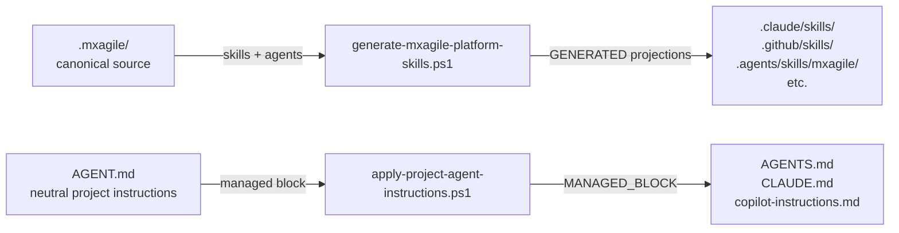

# MxAgile Repository Development Instructions

## Purpose

This repository develops the MxAgile framework itself.

Do not confuse framework development with a Mendix project that has MxAgile installed.

## Architecture

The canonical public bootstrap entry points are:

- mxagile-setup.ps1
- mxagile-setup-mercedes.ps1

Both delegate actual installation to:

- scripts/install-core.ps1

The older `install-mxagile.ps1` and `install-mxagile-mercedes.ps1` are deprecated wrappers
that delegate to the canonical scripts above.

`install-core.ps1` is also the canonical entry point for existing-project Core synchronization.
It retires stale framework-owned artifacts and re-installs the current Core payload while
preserving project-owned state, migration history, and Company Layers.

Do not duplicate installation behavior in the public bootstrap scripts.

## Source of Truth

.mxagile/ is the agent-agnostic source for MxAgile framework skills and agents.

Platform projections are generated artifacts.

Do not manually edit generated MxAgile projections.

After changing canonical agent/skill sources, use the canonical projection generator.

## Agent Instruction Architecture

AGENT.md is the neutral project-instruction source used by MxAgile installations.

Platform-specific files such as AGENTS.md, CLAUDE.md and Copilot instructions are
projections/adapters.

Changes to injected Agent behavior should normally originate from the canonical source,
not individual platform projections.

## Company Layers

Company Layers are external extensions of MxAgile Core.

The canonical installer supports:

- Git source
- explicit Local source

Do not introduce an implicit local Company Layer fallback.

## Architecture Overview

Generated platform projections must not be manually maintained.
Canonical source changes flow through the generator.

## Brownfield Artifact Canonicalization

Framework migration (DFC-AI → MxAgile) and artifact canonicalization are distinct lifecycles.

A project with `status: complete` in `.mxagile/migration/state.yaml` AND
`artifact_canonicalization: pending` is in valid HYBRID mode — migration complete,
canonicalization not yet started. Normal MxAgile project work can proceed in hybrid mode.

Canonicalization converts legacy `.md` stories to canonical `.yml` artifacts
(`requirements/REQ-NNN.yml`, `specs/SPEC-NNN.yml`, `planning/tasks/TASK-NNN.yml`).
See `.mxagile/skills/migration.md` and `docs/schemas.md`.

## Reference Documentation

- [docs/injection-contract.md](docs/injection-contract.md) — authoritative artifact ownership contract
- [docs/architecture.md](docs/architecture.md) — detailed architecture diagrams
- [docs/schemas.md](docs/schemas.md) — canonical artifact schema contract (Requirement/Spec/Task)
- [docs/installation.md](docs/installation.md) — installation and Core update guide

## mxcli

`mxcli.exe` is the required Mendix engineering tool.

- Installer: `scripts/install-mxcli.ps1`
- Updater: `scripts/install-mxcli.ps1` (distributed to projects as `update-mxcli.ps1`)
- Ownership: MxAgile Core

Do not change mxcli installation without updating the canonical installer.

## Commit Identity

Before creating any commit in this repository, verify that both the effective
author and committer identity are exactly `Zwergomaniac <Keeperdeluxe@web.de>`.
Check `git var GIT_AUTHOR_IDENT` and `git var GIT_COMMITTER_IDENT`; do not rely
on a prior session or terminal. Keep this identity repository-local. Never
change the user's global Git identity. If either identity differs or cannot be
verified, stop before committing and ask the maintainer to configure the local
identity. Never rewrite historical author/committer metadata without explicit
user approval.

## Testing Strategy

- Tier 0: parser/static/marker validation — run first, run often
- Tier 1: managed block fixtures, injection snapshot, platform projection tests
- Tier 2: canonical install into disposable fixture project
- Tier 3+: E2E bootstrap (expensive — run on significant changes only)

See `tests/` directory for existing test suite.

## External Skills

External implementation aids are active in this repository.
They do not own or replace any MxAgile lifecycle, scope or evidence contract.

**Instruction precedence (highest to lowest):**

1. Explicit current user instruction
2. MxAgile safety, lifecycle, scope and evidence contracts
3. Repository-specific rules (this file)
4. External skills (Ponytail, Superpowers-derived)

**Authority constraints for external skills:**

- Unavailable verification is not passed verification. Failed, unavailable and successful evidence remain distinct.
- An external skill must not create subagents, worktrees, branches or alternate plans without explicit MxAgile mission permission.
- Re-check repository state before relying on prior session assumptions.
- Minimal means smallest *complete* change, not smallest textual diff.
- Existing validated functionality must be preserved.
- An external skill must not cause repeated clarification loops when the active mission is already sufficiently specified.

**Active skills** (trigger-loaded on demand, not always loaded):

| Skill | Trigger | Origin |
|-------|---------|--------|
| `ponytail` | `/ponytail`, "be lazy", "simplest solution", "yagni" | DietrichGebert/ponytail |
| `systematic-debugging` | `/systematic-debugging` | obra/superpowers |
| `verification-before-completion` | `/verification-before-completion` | obra/superpowers |
| `requesting-code-review` | `/requesting-code-review` | obra/superpowers |
| `receiving-code-review` | `/receiving-code-review` | obra/superpowers |
| `diagnosing-agent-session` | `/diagnosing-agent-session` | obra/superpowers (adapted) |

See `docs/external-skills.md` for rationale, provenance and rollback.
